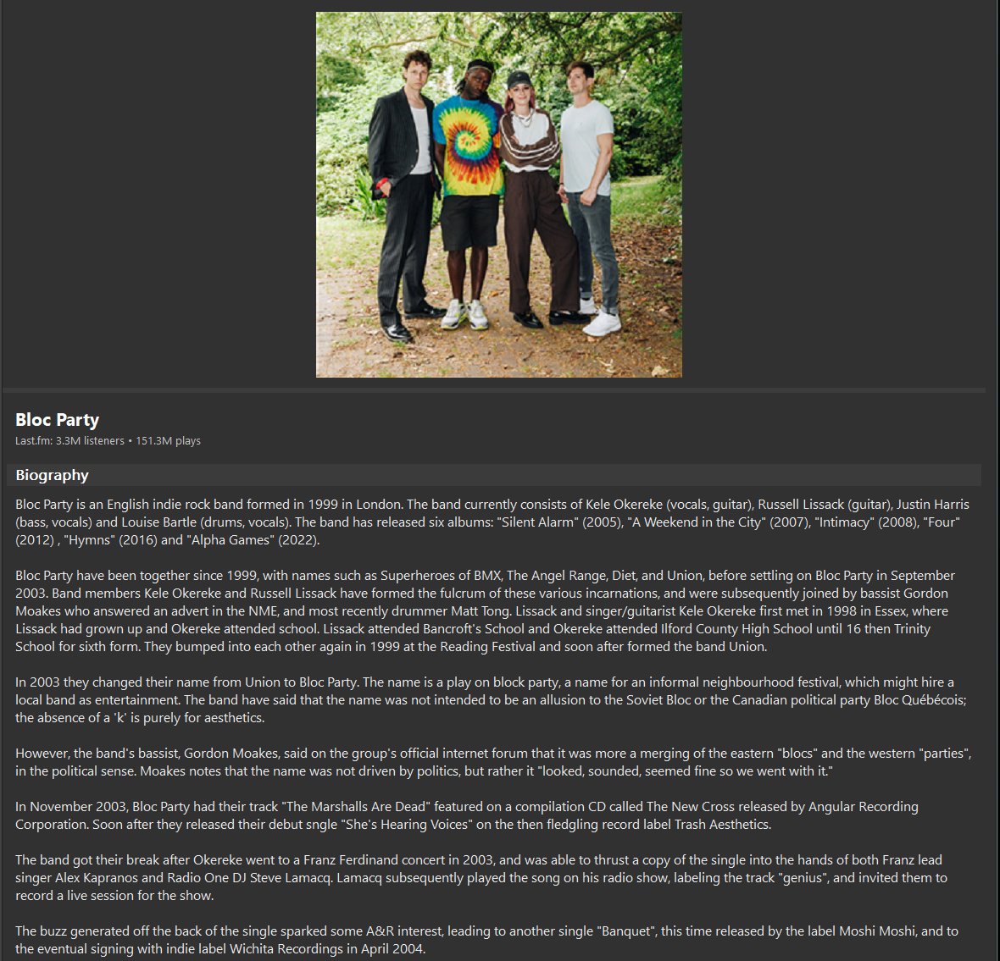
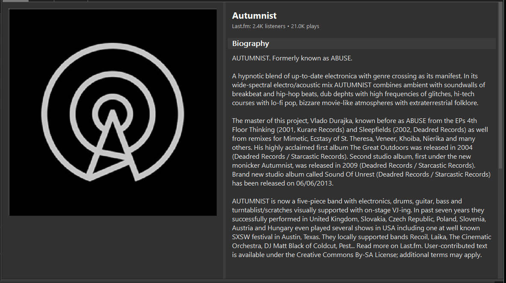

# Artist Biography Viewer for foobar2000

> **Status: archived (no longer maintained).** The source code is kept for reference.
> Prebuilt components were removed in November 2026 because they contained API credentials
> that have since been revoked or retired. To use the component you need to build it yourself
> and supply your own Spotify and Last.fm API keys.

A foobar2000 UI panel that shows the biography, image, listener statistics, top tracks and
similar artists for the currently playing artist, using data from Last.fm and Spotify.

## Screenshots

| Vertical layout | Horizontal layout |
|---|---|
|  |  |

## Features

- **Two layouts:** image beside the text or above it; double-click to switch, drag the divider to resize.
- **Artist information:** biography with correct Unicode rendering, listeners and play counts,
  top tracks and albums, similar artists.
- **Theme aware:** follows the foobar2000 dark/light mode.
- **Layout Edit Mode:** layout options are available from the foobar2000 edit-mode menu.
- **Persistent content (v30):** the last loaded artist stays visible after restart.

## Source files

| File | Version | Notes |
|---|---|---|
| `artist_bio_v30_PERSISTENT.cpp` | 30.0.0 | Latest version |
| `artist_bio_v14_FINAL.cpp` | 27.0.0 | Previous version, kept for reference |

## Building

There is no project file in this repository. To build the component:

1. Create a Visual Studio 2022 C++ DLL project (x64, Release).
2. Add the [foobar2000 SDK](https://www.foobar2000.org/SDK) (tested with SDK 2025-03-07) and
   reference its `foobar2000_SDK`, `pfc`, `helpers`, `shared` and `foobar2000_component_client` projects.
3. Add `artist_bio_v30_PERSISTENT.cpp` and link `winhttp.lib`, `wininet.lib`, `gdiplus.lib`.
4. Fill in your own keys: `SPOTIFY_CLIENT_ID`, `SPOTIFY_CLIENT_SECRET`
   ([Spotify for Developers](https://developer.spotify.com/dashboard)) and `api_key`
   ([Last.fm API](https://www.last.fm/api/account/create)). Do not commit them.
5. Package the DLL as a `.fb2k-component` (a zip archive) and install it in foobar2000.

## Security notes

- Earlier versions embedded API credentials in the source and disabled TLS certificate
  validation. Both were removed in [#2](https://github.com/veselyvaclavcz/foo_artist_view/pull/2);
  all requests now use HTTPS with full certificate validation.
- Old credentials remain in the git history. The Spotify application was deleted; the
  Last.fm key is retired and must not be used.

## Changelog

- **30.0.0 (2025-08-29):** persistent content between sessions.
- **28.0.0 (2025-08-18):** Layout Edit Mode menu support.
- **23.0.0 – 27.0.0:** Unicode text rendering, image scaling, draggable dividers, header formatting.

## License

MIT, see [LICENSE](LICENSE). foobar2000 and its SDK are subject to their own license terms.
